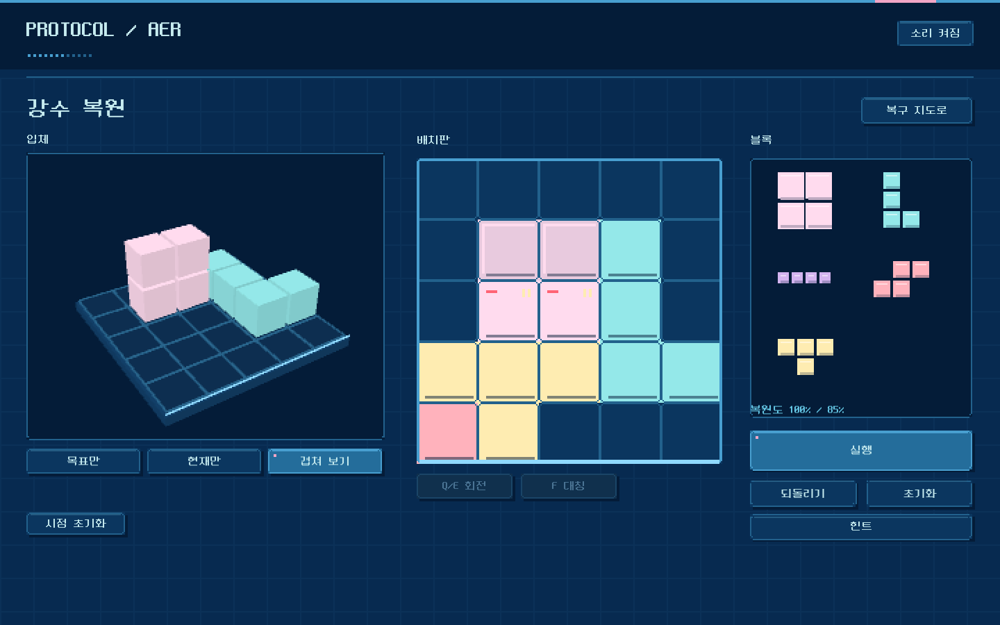

# Protocol Aer

5×5 평면에 미노를 배치하고, 겹침과 효과로 완성 형태의 설계 원리를 찾는 Unity 퍼즐 프로토타입입니다.



**[Windows 실행판 다운로드](https://github.com/marimiri/ppoppi/releases/latest)**

## 실행하기

Windows 배포 ZIP을 **전체 압축 해제**한 뒤 `ProtocolAer.exe`를 실행하세요. 실행 파일 옆의 `ProtocolAer_Data`, `UnityPlayer.dll`, `MonoBleedingEdge`도 함께 있어야 합니다.

소스만 내려받았다면 아래의 Unity 실행 방법을 이용하세요.

## 플레이 구성

- 선택형 튜토리얼 3개
- 레이더 지도에서 명칭 찾기 4개 → 일조 복원 → 명칭 찾기 4개 → 강수 복원 → 종료
- 명칭은 복원도 100%, 날씨는 85% 이상이 필요합니다. 새 미노를 소개하는 명칭 스테이지에서는 해당 효과도 활용해야 합니다.
- 미노 개수는 무제한입니다. 저장 기능은 없으며 종료하면 진행이 초기화됩니다.

| 미노 | 등장 | 효과 |
|---|---|---|
| O | 처음부터 | +1 |
| L | 명칭 3지역 | +1 |
| I | 명칭 5지역 | +1 |
| S | 명칭 7지역 | 겹친 O·L·I **전체**의 효과 반전 |
| T | 명칭 8지역 | 겹친 O·L·I **전체**의 효과 두 배 |

S·T는 자체 높이를 만들지 않는 연산 미노입니다. 일반 미노의 네 칸 중 **한 칸만 겹쳐도 네 칸 전체**가 변합니다. S만 겹치면 −1, T만 겹치면 +2, 둘 다 겹치면 −2씩 작동합니다. 같은 효과는 여러 개 겹쳐도 한 번만 적용되며, 다른 미노를 통한 연쇄나 배치 순서 차이는 없습니다. 최종 음수 높이는 0이 됩니다.

바람길은 전체 반전, 환경 제어실은 증폭과 반전의 조합, 마지막 강수 복원은 두 효과를 종합하는 목표로 구성했습니다. 명칭 1~6지역과 첫 번째 날씨 목표는 그대로입니다. 일반 미노 모서리의 빨간 짧은 선은 반전, 노란 두 줄은 증폭 표시입니다.

## 조작

- 오른쪽 미노 클릭 → 2D 보드 위에서 예상 결과 확인 → 클릭해서 배치
- 놓을 수 없는 칸이나 보드 밖 빈 공간 클릭: 들고 있는 미노 반환
- 이미 놓인 미노 클릭: 집어서 이동
- Q/E/R: 회전 · F: 대칭 · 우클릭/Esc: 반환 · Ctrl+Z: 되돌리기
- 3D 화면 드래그/WASD: 시점 회전 · 마우스 휠: 확대·축소
- 하늘색 보드 모서리: 2D 보드 아래쪽에 대응하는 고정 기준선
- 실행: 복원 판정. 성공한 경우에만 3D 결과가 불투명하게 채워집니다.

힌트는 현재 배치와 예시 해법을 비교합니다. **금색은 놓을 위치와 클릭 기준 칸**, **빨간색은 먼저 옮기거나 반환할 미노**입니다. 놓기 힌트에서는 종류와 방향도 자동으로 맞춰 줍니다. 힌트만 누르는 것으로 배치가 확정되거나 제거되지는 않습니다.

## Unity에서 열기

1. Unity Hub에 **Unity 6000.3.24f1**과 Windows Build Support를 설치합니다.
2. 이 폴더를 프로젝트로 추가합니다. `Assets`, `Packages`, `ProjectSettings`가 같은 위치에 있어야 합니다.
3. `Assets/Scenes/Main.unity`를 열고 Play를 누릅니다.

글꼴·사진·셰이더는 프로젝트에 포함되어 있습니다. 별도로 구매하거나 설정할 에셋은 없습니다.

## Windows 빌드

Unity 상단 **Protocol Aer → Build Windows**를 선택합니다. 결과는 `Builds/ProtocolAer.exe`에 생성됩니다.

에디터를 닫고 PowerShell에서 빌드할 수도 있습니다.

```powershell
powershell -ExecutionPolicy Bypass -File .\Tools\BuildWindows.ps1
```

자동 검증을 재실행할 때는 다음 명령을 사용합니다. 게임 창이 열리고 완료 후 자동 종료됩니다.

```powershell
powershell -ExecutionPolicy Bypass -File .\Tools\VerifyWindows.ps1
```

## 구성

- `Assets/Scripts/ProtocolAer.cs`: 화면, 입력, 진행, 3D 표시
- `Assets/Scripts/EveningBoard.cs`: 미노 배치와 높이 계산
- `Assets/Scripts/AerStages.cs`: 스테이지와 복원 판정
- `Assets/Scripts/AerHints.cs`: 현재 배치 기반 힌트
- `Assets/Scripts/AerTargetOutline.cs`: 블록 이음새를 제외한 입체 표면 모서리
- `Assets/Editor/AerBuilder.cs`: 해법 검사 및 Windows 빌드
- [검증 결과](docs/검증결과.txt) · [개발 상세](docs/Development.md) · [조작 안내](조작안내.txt)

`Library`, `Temp`, `Logs`, `Builds`는 Git에 포함하지 않습니다. `.meta` 파일은 에셋 연결에 필요하므로 함께 올려야 합니다. 개발용 원본은 이 저장소에, Windows 실행판은 [Releases](https://github.com/marimiri/ppoppi/releases/latest)에 있습니다.

## 글꼴

NeoDunggeunmo와 Rock Salt를 사용합니다. 원본 라이선스는 `Assets/Resources/Fonts/Pixel-OFL.txt`, `Assets/Resources/Fonts/ChalkHand-License.txt`에 포함되어 있습니다.
